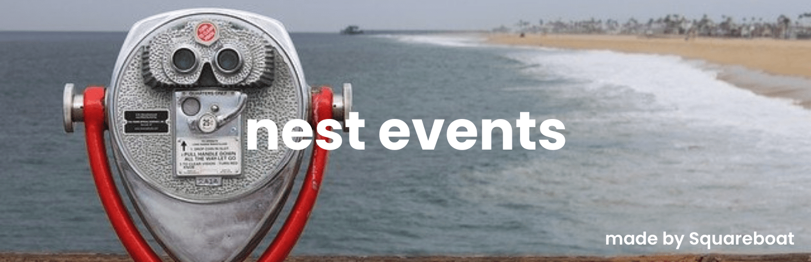

<br />

<div align="center"><strong>Integrate event listeners easily inside your nestjs application</strong></div>

<div align="center">Custom implementation of event listeners. Now, run your decoupled code beautifully without ever bothering of shaking the main code.</div>

## Features

- *__Quick Setup__* - Quickly setup and configure your application

- *__Loose coupling__* - Run codes in parallel accross modules, so that you never need to tightly couple the code.

## Usage

Register `EventModule` once, in your root module. It is global.

```typescript
import { Module } from "@nestjs/common";
import { EventModule } from "@squareboat/nest-events";

@Module({ imports: [EventModule], providers: [UserListeners] })
export class AppModule {}
```

Define an event. Its own properties become the payload that listeners receive.

```typescript
import { Event, EmitsEvent } from "@squareboat/nest-events";

@Event("USER_SIGNED_UP")
export class UserSignedUp extends EmitsEvent {
  constructor(public email: string) {
    super();
  }
}
```

Listen to it from any provider. Listeners can be `async`; declare the return type as `Promise<void>`, not `void`.

```typescript
import { Injectable } from "@nestjs/common";
import { ListensTo } from "@squareboat/nest-events";

@Injectable()
export class UserListeners {
  constructor(private readonly mailer: MailService) {}

  @ListensTo("USER_SIGNED_UP")
  async sendWelcomeMail(payload: { email: string }): Promise<void> {
    await this.mailer.send(payload.email);
  }
}
```

Emit it. `emit()` runs the listeners at the same time and resolves when all of them have finished. If a listener throws or rejects, `emit()` rejects right away, without waiting for the others.

```typescript
await new UserSignedUp("ann@example.com").emit();
// or
await EmitEvent(new UserSignedUp("ann@example.com"));
```

`@ListensTo()` also accepts the event class, which matches the class name. If you pass a custom name to `@Event()`, listen with that same name.

## Contributing
To know about contributing to this package, read the guidelines [here](./CONTRIBUTING.md)

## About Us

We are a bunch of dreamers, designers, and futurists. We are high on collaboration, low on ego, and take our happy hours seriously. We'd love to hear more about your product. Let's talk and turn your great ideas into something even greater! We have something in store for everyone. [☎️ 📧 Connect with us!](https://squareboat.com/contact)

## License

The MIT License. Please see License File for more information. Copyright © 2020 SquareBoat.

Made with ❤️ by [Squareboat](https://squareboat.com)
